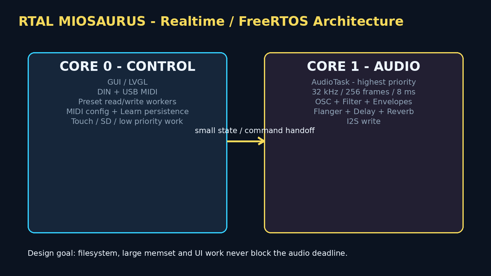
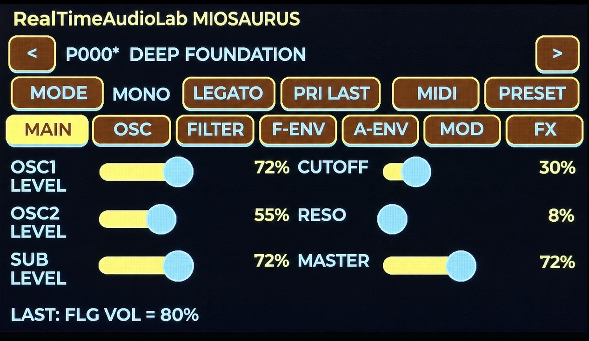
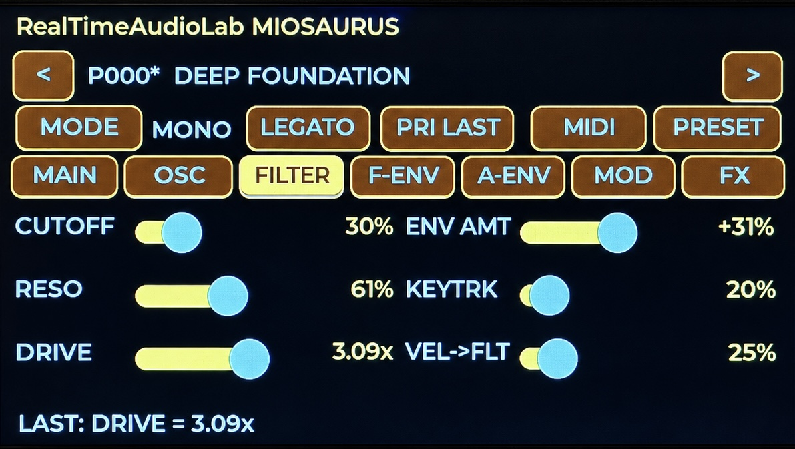
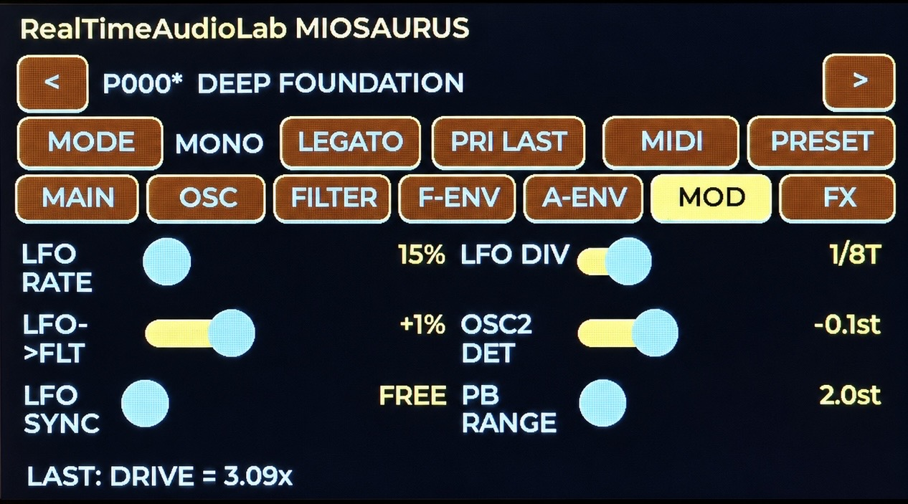
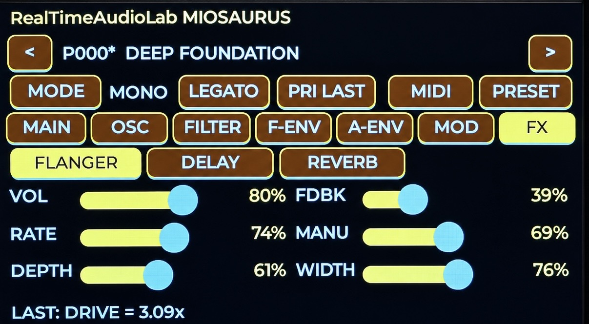
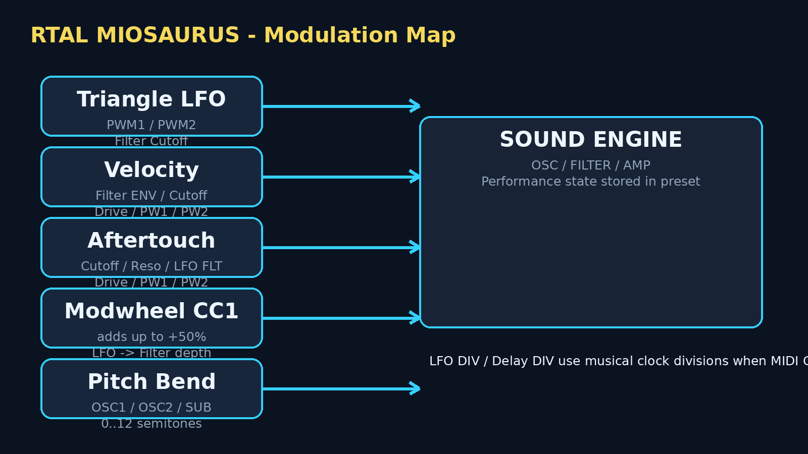
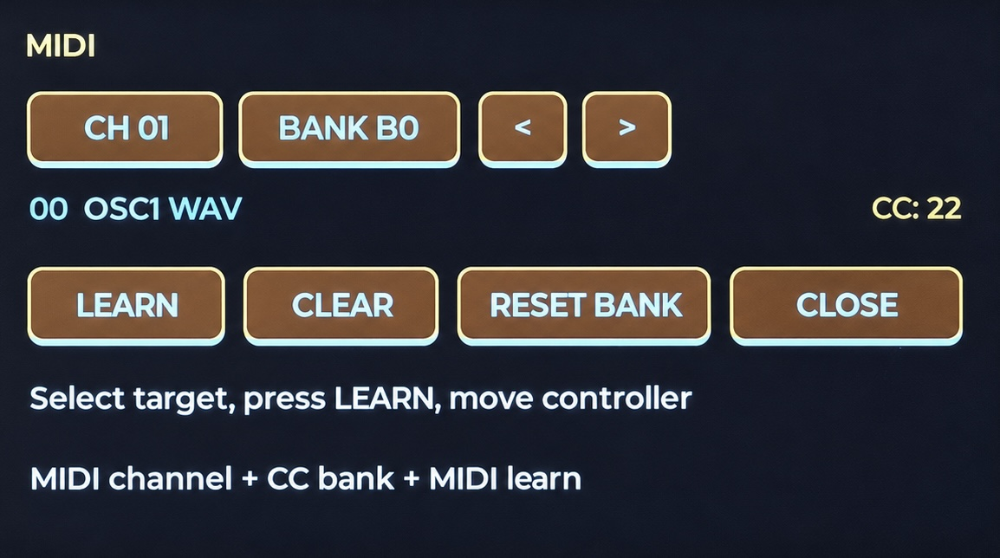

# RTAL MIOSAURUS

https://github.com/user-attachments/assets/e4182e42-5c0f-431b-ac0a-019e10d87a53

**Firmware V0.14B FIX7 - Pre-V1.0 Release Candidate Basis**

> Mono / two-note paraphonic ESP32-S3 touch synthesizer with 128-step morphing, resonant filter, MIDI Learn, 128 SD presets and additive stereo FX returns.

## Quick Start

1. Connect I2S DAC, MIDI and SD card.
2. Power on and wait for the splash screen.
3. Set MIDI to OMNI or CH01..16.
4. Load P000 and play a note.
5. Enable modulation and FX gradually.

## Highlights

| Area | Current implementation |
|---|---|
| Audio | 32,000 Hz, 256 frames, 8.0 ms block budget, stereo I2S |
| Synthesis | 2 main oscillators + sub; 128-step SAW-SQR morph |
| Play modes | MONO and 2-note paraphonic PARA2, Legato, LAST/LOW/HIGH priority |
| Filter | Resonant 4-stage filter, drive, envelope, key tracking, velocity |
| Modulation | Triangle LFO, PWM, filter LFO, velocity, channel aftertouch, modwheel, pitch bend |
| Effects | Additive stereo returns: flanger, ping-pong delay, light reverb |
| Presets | 128 slots P000-P127, V1/V2 compatibility, CRC32, backup/recovery |
| MIDI | DIN UART + native USB MIDI, PC, CC, clock, learn, B0/B1 |
| GUI | JC4827W543, 480x272 touch, NV3041A + GT911 |

## Architecture




## User Interface

### MAIN


### OSC / Morph


### FILTER


### MOD / LFO


### FLANGER


### DELAY


### REVERB


## Modulation



- Triangle LFO: FREE or MIDI-clock SYNC.
- Modwheel CC1 increases LFO->filter depth; no pitch vibrato.
- Velocity and channel aftertouch have selectable destinations.
- Pitch bend affects OSC1, OSC2 and SUB globally.

## Presets


128 Slots P000-P127. Async SD read, request-ID, 45-ms Program-Change-Coalescing, CRC32, tmp/bak recovery and V1/V2 compatibility.

## MIDI / CC Banks



```text
CC32 = 0 -> B0
CC32 = 1 -> B1
CC32 = 2 -> intentionally unused / ignored
```

Reserved CCs: **1, 32, 120, 123**.

## Performance

| Test | A avg | A max | over8 | CTRL max | i2s / short |
|---|---:|---:|---:|---:|---:|
| FIX2 steady | 4.9-5.5 ms | ~27 ms historical | 3-5 | 531 us | 0 / 0 |
| V0.14A Morph | 6.0-6.2 ms | 28.45 ms historical | 1-2 | 519 us | 0 / 0 |
| V0.14B Reverb | ~6.72 ms | 8.117 ms | 1 | 446 us | 0 / 0 |

## Documentation

- [German manual](docs/RTAL_MIOSAURUS_Handbuch_DE.pdf)
- [English manual](docs/RTAL_MIOSAURUS_Manual_EN.pdf)

## Path to V1.0.0

- Worst-case PARA2 + centered morph + all FX
- Full DIN/USB MIDI audit
- Preset V1/V2 and MIDI Learn persistence
- 30-60 minute endurance test
- Version/debug cleanup and documentation freeze
