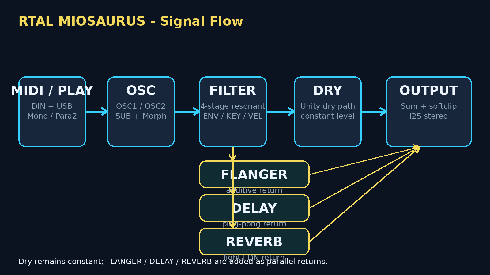
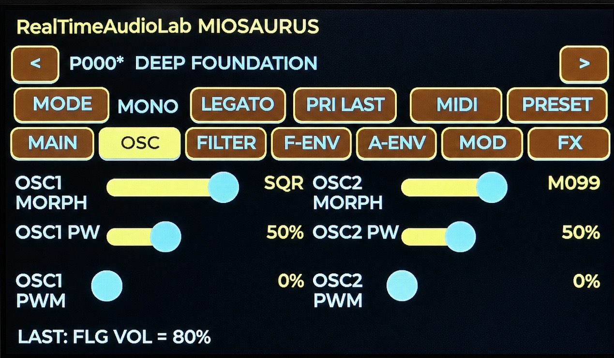
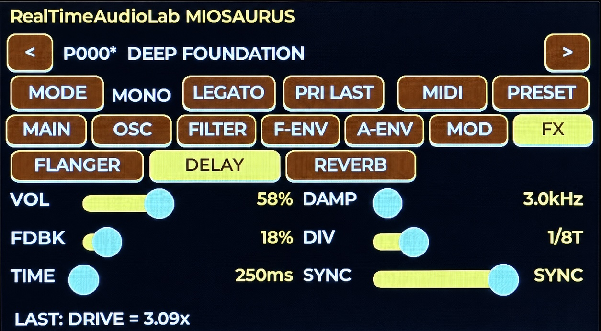
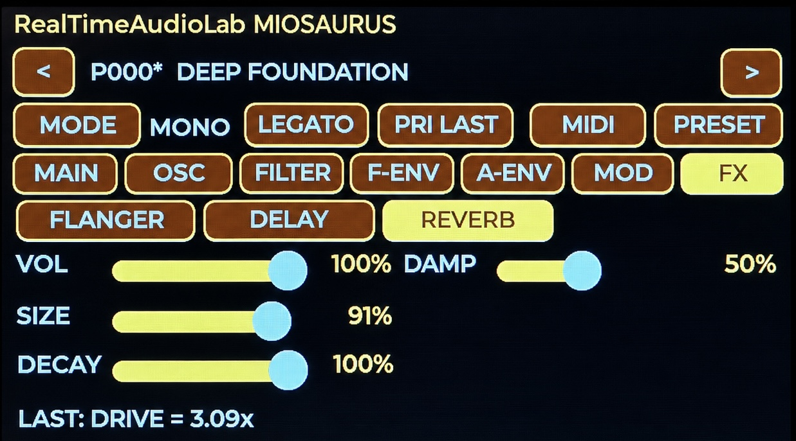
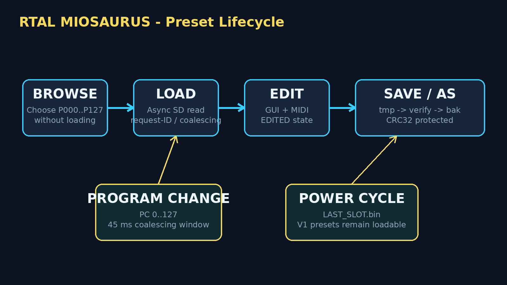
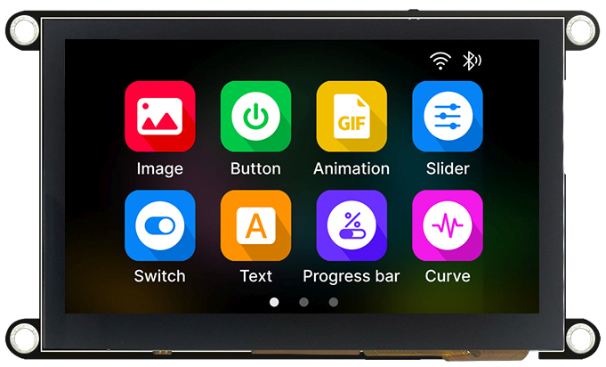
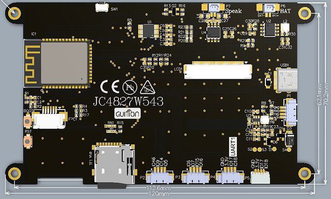
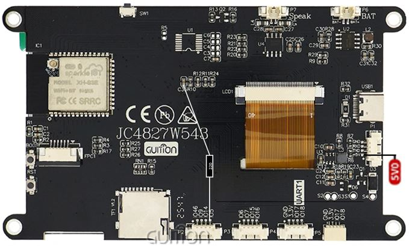
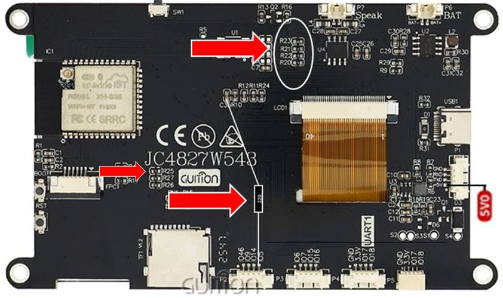

# RTAL MioSaurus Synthesizer

https://github.com/user-attachments/assets/e4182e42-5c0f-431b-ac0a-019e10d87a53

**Firmware V1.0.0**

> Mono / two-note paraphonic ESP32-S3 touch synthesizer with 128-step morphing, resonant filter, MIDI Learn, 128 SD presets and additive stereo FX returns.

## Quick Start

1. Connect I2S DAC, MIDI and SD card.
2. Power on and wait for the splash screen.
3. Set MIDI to OMNI or CH01..16.
4. Load P000 and play a note.
5. Enable modulation and FX gradually.

## Highlights

| Area | Current implementation |
|---|---|
| Audio | 32,000 Hz, 256 frames, 8.0 ms block budget, stereo I2S |
| Synthesis | 2 main oscillators + sub; 128-step SAW-SQR morph |
| Play modes | MONO and 2-note paraphonic PARA2, Legato, LAST/LOW/HIGH priority |
| Filter | Resonant 4-stage filter, drive, envelope, key tracking, velocity |
| Modulation | Triangle LFO, PWM, filter LFO, velocity, channel aftertouch, modwheel, pitch bend |
| Effects | Additive stereo returns: flanger, ping-pong delay, light reverb |
| Presets | 128 slots P000-P127, V1/V2 compatibility, CRC32, backup/recovery |
| MIDI | DIN UART + native USB MIDI, PC, CC, clock, learn, B0/B1 |
| GUI | JC4827W543, 480x272 touch, NV3041A + GT911 |

## Architecture




## User Interface

### MAIN


### OSC / Morph


### FILTER


### MOD / LFO


### FLANGER


### DELAY


### REVERB


## Modulation


- Triangle LFO: FREE or MIDI-clock SYNC.
- Modwheel CC1 increases LFO->filter depth; no pitch vibrato.
- Velocity and channel aftertouch have selectable destinations.
- Pitch bend affects OSC1, OSC2 and SUB globally.

## Presets



128 Slots P000-P127. Async SD read, request-ID, 45-ms Program-Change-Coalescing, CRC32, tmp/bak recovery and V1/V2 compatibility.

## MIDI / CC Banks


```text
CC32 = 0 -> B0
CC32 = 1 -> B1
CC32 = 2 -> intentionally unused / ignored
```

Reserved CCs: **1, 32, 120, 123**.

## Performance

| Test | A avg | A max | over8 | CTRL max | i2s / short |
|---|---:|---:|---:|---:|---:|
| FIX2 steady | 4.9-5.5 ms | ~27 ms historical | 3-5 | 531 us | 0 / 0 |
| V0.14A Morph | 6.0-6.2 ms | 28.45 ms historical | 1-2 | 519 us | 0 / 0 |
| V0.14B Reverb | ~6.72 ms | 8.117 ms | 1 | 446 us | 0 / 0 |

## JC4827W543 — ESP32-S3 touchscreen board and RTAL hardware modifications

The **Guition JC4827W543** is the compact MAIN platform used by RTAL SYNTECH. It combines an ESP32-S3 with a **480 × 272 NV3041A QSPI LCD**, **GT911 capacitive touchscreen**, microSD connectivity and interfaces for the external I²S audio and MIDI circuitry. For SYNTECH, the board is more than a display: it runs the touch interface, MIDI processing and real-time synthesizer engine.

### Board photographs and modification gallery

The following image paths are **placeholders for original photographs** of the actual modified board; no board photographs were supplied with this README update. Add the images to the repository under `images/hardware/` to display them on GitHub.

| Board overview — front | Board overview — rear |
|:--:|:--:|
|  |  |
| **480 × 272 touchscreen and MAIN module** | **PCB and hardware modification locations** |

| Display reset modification | GPIO expansion modification |
|:--:|:--:|
|  |  |
| **220 Ω from GPIO5 to RSTI** | **R20–R23 and R25 removed** |

### Why the board was modified

During development, the NV3041A display occasionally failed to initialize correctly after power-up or a microcontroller restart. Symptoms included an incomplete image or a persistent cross on the screen, while the synthesizer's other functions could still run. Software-only initialization changes did not reliably eliminate the issue. The display RESET line originally relied on its passive power-on RC network, which does not provide a firmware-controlled reset pulse whenever the ESP32-S3 restarts.

The modifications serve **two distinct purposes**: (1) provide the display controller with an explicit, repeatable reset sequence, and (2) reserve additional ESP32-S3 GPIO resources for the planned multi-controller SYNTECH V2.0 architecture.

### Modification 1 — firmware-controlled NV3041A reset (GPIO5)

**Implemented hardware change:** A **220 Ω series resistor** was connected from **ESP32-S3 GPIO5** to **RSTI**, specifically the PCB node where **R10 and C35 meet**. **R25 was removed** to free GPIO5 for this dedicated function. The existing reset-network components **R10 and C35 remain fitted**.

```text
ESP32-S3 GPIO5 ---- 220 Ω ----+---- RSTI (NV3041A display reset)
                              |
                              +---- R10 ---- 3.3 V
                              |
                              +---- C35 ---- GND

R25: removed to release GPIO5 for the display-reset function.
```

**Engineering rationale:** The original R10/C35 network generates a passive reset behavior associated with power-up, but it cannot guarantee a fresh reset of the display controller on every software restart or under all power sequencing conditions. With GPIO5 connected to RSTI, the firmware can deliberately assert the NV3041A's **active-low reset** before initializing its QSPI interface. The **220 Ω resistor** limits transient current and provides some isolation when the reset capacitor is discharged; it is **not** a voltage-level converter. The existing pull-up and capacitor are retained, so RSTI returns to its inactive high state when the GPIO is released.

The FIX5 implementation drives GPIO5 as **open-drain**: hold **LOW for 50 ms**, release the line, then wait **150 ms** before calling the NV3041A initialization routine. Open-drain operation avoids actively driving the reset node high against the existing RC circuit. The GPIO5/RSTI connection was installed and **the developer confirmed that SYNTECH operates with this modification**; a statistically significant cold-start reliability test has not yet been documented.

> [!IMPORTANT]
> **RSTI is the display-controller reset node, not the ESP32-S3 EN/reset pin.** The solder point is the junction of **R10 and C35**. Disconnect all power before soldering and verify the pad, resistor value and absence of shorts against the actual PCB revision. Removing R25 changes the board's original circuitry; the original function of R25 must be checked against the corresponding board schematic before applying this modification to another revision.

### Modification 2 — additional GPIO availability (R20, R21, R22, R23)

**Implemented hardware change:** **R20, R21, R22 and R23 were removed** to make additional GPIO connections available for project-specific expansion. These are board-level modifications, not firmware settings. The precise original functions and net assignments of these four components must be confirmed against the schematic for the specific PCB revision; their removal should not be assumed safe on an unmodified board of another revision.

The primary intended use is the planned **RTAL SYNTECH V2.0.0 multi-ESP32-S3 architecture**. In particular, **GPIO41 and GPIO42** are reserved as a **UART TX/RX pair** for communication with additional ESP32-S3 modules. The final direction, peripheral assignment, physical wiring and protocol are subject to V2.0 integration tests; a proposed mapping is **GPIO41 → MAIN TX** and **GPIO42 → MAIN RX**.

```text
              RTAL SYNTECH V2.0 — planned UART link

    JC4827W543 MAIN                         ESP32-S3 expansion module
    GPIO41  (UART TX) --------------------> UART RX
    GPIO42  (UART RX) <-------------------- UART TX
    GND                -------------------- GND

    Logic levels: 3.3 V; no direct connection to RS-232 voltage levels.
```

This gives the MAIN controller a dedicated channel for low-latency **control messages, note events, parameter updates and status/diagnostic information** while leaving audio DSP on the respective modules. **The UART link is a development plan, not a validated V2.0 feature.** If the future architecture requires simultaneous connections to multiple modules, separate UART resources or a suitably designed shared communication topology must be defined; GPIO41/42 alone are one TX/RX pair.

### Modification summary and validation status

| PCB component / signal | RTAL modification | Purpose | Status |
|:--|:--|:--|:--|
| **GPIO5 → 220 Ω → RSTI** | Added wire and series resistor at **R10/C35 junction** | Controlled NV3041A reset | **Installed; SYNTECH operation confirmed** |
| **R25** | Removed | Release GPIO5 for reset control | **Installed modification** |
| **R10 / C35** | Retained | Existing display-reset pull-up / timing network | **Retained** |
| **R20, R21, R22, R23** | Removed | Expose additional GPIO resources | **Reported hardware modification** |
| **GPIO41 / GPIO42** | Reserved for UART TX / RX | Future MAIN-to-expansion-module link | **Planned for V2.0; not yet validated** |

> [!NOTE]
> These modifications document the **RTAL development board**, not a general manufacturer-recommended modification procedure. Hardware revisions, solder points and resistor functions must be verified against the actual JC4827W543 PCB before reproducing the work.


## Build & installation

**Required hardware:** Guition JC4827W543 ESP32-S3 display board (NV3041A QSPI, GT911 touchscreen), microSD card, external I²S-compatible DAC/audio output stage and optionally a DIN-MIDI interface with proper electrical circuitry. Firmware pin constants include **I²S BCLK GPIO16, LRCK GPIO15, DOUT GPIO7**, **DIN MIDI RX GPIO17, TX GPIO18**, and SD SPI **SCK GPIO12, MISO GPIO13, MOSI GPIO11, CS GPIO10**. See [`PINS_JC4827W543.h`](firmware/RTAL_SYNTECH_V1_0_0_FINAL/PINS_JC4827W543.h) for display and touch wiring.

1. Prepare **Arduino IDE 2.3.10**, **Arduino-ESP32 core 3.3.11** and **LVGL 8.4.x**, the firmware's documented development baseline. Use a compatible ESP32-S3 board profile with the board's 16 MB flash / 8 MB PSRAM configuration. The firmware requires **USB Mode → USB-OTG (TinyUSB)** because it uses USB MIDI.
2. Open [`RTAL_SYNTECH_V1_0_0_FINAL.ino`](firmware/RTAL_SYNTECH_V1_0_0_FINAL/RTAL_SYNTECH_V1_0_0_FINAL.ino) **inside its directory**, keeping sibling `.cpp`, `.c` and `.h` files in place. Refer to the supplied `lv_conf.h` for the intended LVGL setup.
3. Prepare a microSD card with the directory `/RTAL_SYNTECH/PRESETS/` and compatible, existing `P000.rtal` … `P127.rtal` version-2 preset files. **No complete preset bank is bundled in this release.** The firmware does not synthesize a replacement factory bank and will not reach normal playback without at least one valid preset.
4. Wire the DAC and MIDI safely, compile and flash with the intended hardware. Take an existing SD preset backup before saving patches or changing firmware.

> [!CAUTION]
> This package contains source code but **no independently verified ready-to-flash `.bin`** and **no complete factory preset distribution**. Building and flashing are the user's responsibility. A final reproducible binary build and clean-device acceptance test are still recommended before marking the GitHub release as fully deployment-ready.

## Documentation

- [German manual](docs/RTAL_MIOSAURUS_Handbuch_DE.pdf)
- [English manual](docs/RTAL_MIOSAURUS_Manual_EN.pdf)


